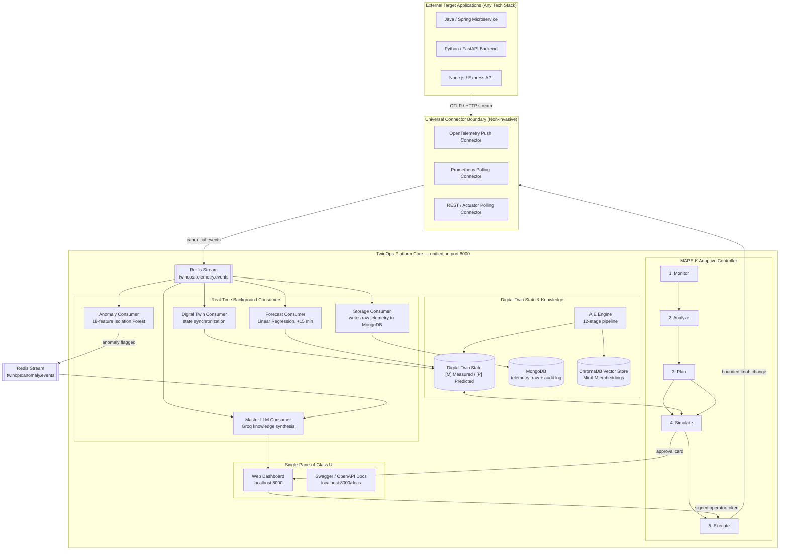
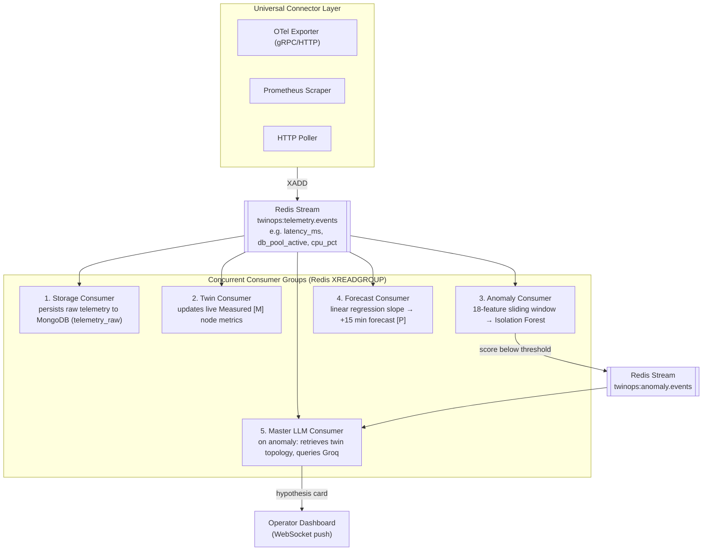
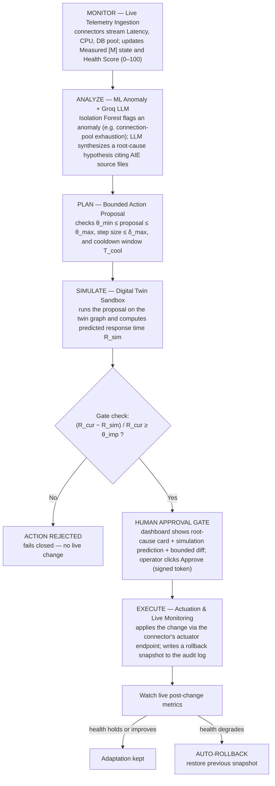
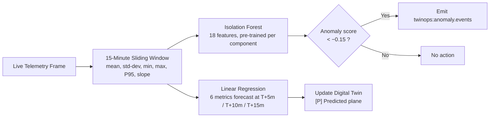
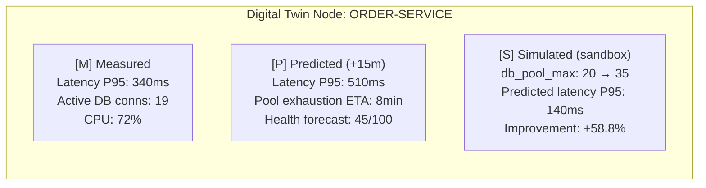

# TwinOps — Self-Adaptive Digital Twin Platform for Autonomous Telemetry & Performance Optimization

> **Based on the IEEE Conference Research Paper:** *"Self-Adaptive Digital Twin Platform for Software Performance Monitoring & Optimization"*
>
> TwinOps is a standalone, non-invasive digital twin platform that connects to any software stack through universal connectors, builds an active architectural digital twin, detects performance anomalies with machine learning, reasons about root causes with an LLM (Groq), validates remediation in a simulated sandbox, and executes bounded, reversible adaptations — always with a human in the loop.

---

## Table of Contents

1. [Core Capabilities & Key Concepts](#core-capabilities--key-concepts)
2. [System Architecture & Design Diagrams](#system-architecture--design-diagrams)
   - [2.1 High-Level System Architecture](#21-high-level-system-architecture)
   - [2.2 AIE 12-Stage Intelligence Pipeline](#22-aie-12-stage-intelligence-pipeline)
   - [2.3 Telemetry Ingestion & Stream Bus](#23-telemetry-ingestion--real-time-stream-bus)
   - [2.4 MAPE-K Closed-Loop Adaptation Cycle](#24-mape-k-closed-loop-adaptation-cycle--safety-gate)
   - [2.5 ML Anomaly Detection & Forecasting](#25-ml-anomaly-detection--forecasting-pipeline)
   - [2.6 Digital Twin Evidence Model (M / P / S)](#26-digital-twin-state--evidence-model-m-p-s)
3. [Safety Guardrails & Paper Constraints](#safety-guardrails--paper-constraints)
4. [Docker Guide (Redis Containerization)](#docker-guide-redis-containerization)
5. [Local Environment Setup](#local-environment-setup)
6. [Running the Application](#running-the-application)
7. [API & Dashboard Endpoints](#api--dashboard-endpoints)
8. [Troubleshooting & FAQs](#troubleshooting--faqs)
9. [Contributors & Academic Reference](#contributors--academic-reference)

---

## Core Capabilities & Key Concepts

### 1. Non-Invasive Connector Boundary
TwinOps never modifies application code or databases directly. It operates exclusively through **Universal Connectors** (OpenTelemetry, Prometheus metrics exporter, REST polling, and actuator endpoints).

### 2. Evidence-Tagged Digital Twin (M / P / S)
Every metric, state variable, and node property in the digital twin graph carries an immutable evidence tag:

| Tag | Meaning | Source |
|:---:|---------|--------|
| `[M]` | **Measured** | Real telemetry observed directly from live connectors |
| `[P]` | **Predicted** | Forecasted values from ML regression models (+15 min window) |
| `[S]` | **Simulated** | Hypothetical outcomes tested in the digital twin sandbox before any production change |

### 3. Application Intelligence Engine (AIE)
A 12-stage analysis pipeline that ingests any Git repository, performs AST-based code extraction, groups files into architectural components using a Groq LLM, builds dependency call graphs, enriches nodes with operational failure modes, and emits machine-readable contract descriptors.

### 4. Bounded, Reversible Autonomous Adaptation
Adaptations (e.g. connection pool resizing, rate-limiter limits, cache TTLs) can never exceed mathematical boundaries:

$$\theta_{min} \le \theta \le \theta_{max}, \qquad |\Delta\theta| \le \delta_{max}$$

Every adaptation requires simulated proof of improvement ($\Delta R \ge \theta_{imp}$), explicit human approval, and triggers automatic rollback if live post-change metrics degrade.

---

## System Architecture & Design Diagrams

### 2.1 High-Level System Architecture



### 2.2 AIE 12-Stage Intelligence Pipeline

The Application Intelligence Engine (AIE) parses and models codebases safely, without ever executing user code.

```mermaid
flowchart TD
    Start(["Git Repository URL<br/>(public, or private with a PAT)"]) --> S1
    S1["1. Ingestion<br/>safe clone into an isolated sandbox workspace"] --> S2
    S2["2. Classifier<br/>filters junk (.git, node_modules, binaries); tags files as source / config / docs"] --> S3
    S3["3. Discovery<br/>inspects package.json, requirements.txt, pom.xml for languages & frameworks"] --> S4
    S4["4. Docs Analyzer<br/>parses README & OpenAPI specs; redacts secrets; flags discrepancies"] --> S5
    S5["5. Static AST<br/>AST traversal extracts imports, class hierarchies, routes, calls"] --> S6
    S6["6. LLM Grouper<br/>Groq groups files & symbols into architecture components"] --> S7
    S7["7. Relationships<br/>resolves import graph + call graph between components"] --> S8
    S8["8. LLM Knowledge<br/>Groq extracts responsibility, failure modes, monitoring needs"] --> S9
    S9["9. Enrichment<br/>injects operational playbooks (Redis evictions, pool limits, etc.)"] --> S10
    S10["10. Validation<br/>cross-checks imports vs AST vs docs; computes confidence 0.0–1.0"] --> S11
    S11["11. Graph Generator<br/>compiles Contract B (Descriptor) & Contract C (Capability Catalog)"] --> S12
    S12["12. Persistence<br/>chunks & embeds with all-MiniLM-L6-v2 into ChromaDB; updates Redis & MongoDB"] --> End(["Queryable Digital Twin State"])
```



#### 12-Stage Processing Matrix

| Stage | Module | Primary Input | Operation | Key Output |
|:---:|---|---|---|---|
| 1 | Ingestion | Git URL + branch | Isolated clone via GitPython; credentials kept in-memory | Cloned workspace directory |
| 2 | Classifier | Workspace files | Path/extension heuristics; skips binaries, lockfiles, venvs | Classified file inventory |
| 3 | Discovery | Manifest files | Parses `requirements.txt`, `package.json`, `pom.xml`, `Dockerfile` | Technology profile |
| 4 | Docs Analyzer | Markdown & YAML | Regex secret sanitizer; extracts documented ports/pools | Cleaned config + discrepancy flags |
| 5 | Static AST | Source code | AST visitor resolves imports, functions, classes, calls | Normalized codebase IR tree |
| 6 | LLM Grouper | IR files & symbols | Groq clusters files into named architecture units | Discovered component nodes |
| 7 | Relationships | Components + call graph | Traces cross-file calls between components | Relationship edges |
| 8 | LLM Knowledge | Component excerpts | Groq extracts responsibility, failure modes, diagnostics | Structured component metadata |
| 9 | Enrichment | Identified tech nodes | Injects curated playbooks (Redis, SQLAlchemy, HikariCP, MongoDB) | Failure-scenario playbooks |
| 10 | Validation | Discovered components | Multi-evidence cross-validation | Confidence scores (0.0–1.0) |
| 11 | Graph Generator | Validated nodes & edges | Compiles architecture contracts | Exportable architecture graph JSON |
| 12 | Persistence | Artifacts & graph | Semantic chunking & embedding | Queryable digital twin state |

### 2.3 Telemetry Ingestion & Real-Time Stream Bus



### 2.4 MAPE-K Closed-Loop Adaptation Cycle & Safety Gate



### 2.5 ML Anomaly Detection & Forecasting Pipeline



### 2.6 Digital Twin State & Evidence Model (`[M]`, `[P]`, `[S]`)

Every monitored entity in the digital twin graph maintains three parallel evidence planes. Example — node `ORDER-SERVICE`:

| Plane | Example values | Source |
|---|---|---|
| **[M] Measured** | Latency P95: 340 ms · Active DB connections: 19 · CPU: 72% | OpenTelemetry, live |
| **[P] Predicted** | Latency P95 (+15 min): 510 ms (ramping) · Pool-exhaustion ETA: 8 min · Health forecast: 45/100 | Linear regression model |
| **[S] Simulated** | Proposed change: `db_pool_max` 20 → 35 · Predicted post-change latency P95: 140 ms · Improvement: +58.8% (exceeds the 15% θ_imp threshold) | Digital twin queueing-model simulation |



---

## Safety Guardrails & Paper Constraints

TwinOps enforces ten architectural guardrails to guarantee safe operation:

1. **Advisory LLM only** — the LLM never triggers a production change directly.
2. **Strict bounds checking** — $p_{min} \le p' \le p_{max}$ and $|\Delta p| \le \delta_{max}$.
3. **Mandatory simulation ($\theta_{imp}$)** — an adaptation must show a statistically significant predicted improvement in the sandbox before it is shown to a human.
4. **Human-in-the-loop** — every actuator signal requires an explicit, cryptographically verifiable approval click.
5. **Cooldown windows ($T_{cool}$)** — prevents oscillatory tuning by enforcing a quiet period between adjustments on the same component.
6. **Automatic rollback** — if real post-adaptation measurements degrade, TwinOps reverses the change using its recorded snapshot token.
7. **Immutable evidence tagging** — `[M]`, `[P]`, and `[S]` labels can never be overwritten or cross-contaminated.
8. **Telemetry isolation** — raw high-frequency metrics never leave the local environment; the LLM only receives compact, bounded evidence summaries.
9. **Zero code injection** — the platform has no SSH, DB-root, or shell execution capability against external apps.
10. **Append-only audit log** — every anomaly detection, simulation result, operator decision, and rollback is permanently recorded.

---

## Docker Guide (Redis Containerization)

TwinOps uses Docker specifically for its high-performance message bus, Redis Streams. MongoDB is typically hosted on MongoDB Atlas, and the Python application runs directly on your local machine.

### 1. Initial Setup (first time on a machine)

**Step 1 — Start Docker Desktop.** Open it from your Start menu or Applications folder and wait for the whale icon to turn steady green ("Engine running").

**Step 2 — Launch the Redis container:**
```powershell
docker run -d --name redis-twinops -p 6379:6379 --restart unless-stopped redis:latest
```
- `-d` — run Redis detached, in the background
- `--name redis-twinops` — name the container for easy management
- `-p 6379:6379` — map container port 6379 to `localhost:6379`
- `--restart unless-stopped` — auto-start Redis when your machine boots
- `redis:latest` — pull the official, lightweight Redis image

**Step 3 — Verify the connection:**
```powershell
docker exec -it redis-twinops redis-cli ping
```
Expected response: `PONG`

### 2. Everyday Workflow (subsequent runs)

| Step | Command | Purpose |
|---|---|---|
| Check status | `docker ps` | Confirm `redis-twinops` is listed with status `Up` |
| Start if stopped | `docker start redis-twinops` | Bring the container back up |
| Stop when done | `docker stop redis-twinops` | Shut the container down |

### 3. Useful Docker Diagnostics

```powershell
# View live Redis logs
docker logs -f redis-twinops

# Inspect TwinOps message streams
docker exec -it redis-twinops redis-cli XLEN twinops:telemetry.events
docker exec -it redis-twinops redis-cli XREAD COUNT 5 STREAMS twinops:telemetry.events 0

# Recreate the container from scratch
docker stop redis-twinops
docker rm redis-twinops
docker run -d --name redis-twinops -p 6379:6379 --restart unless-stopped redis:latest
```

---

## Local Environment Setup

**Prerequisites**
- Python 3.11 or 3.12
- Git
- Docker Desktop (for Redis)
- A Groq API key — [console.groq.com/keys](https://console.groq.com/keys)

**1. Clone the repository**
```bash
git clone https://github.com/jashwanthkv/twinops.git
cd twinops
```

**2. Create a virtual environment**
```powershell
python -m venv venv
.\venv\Scripts\Activate.ps1
```

**3. Install dependencies**
```powershell
pip install --upgrade pip
pip install -r requirements.txt
```

**4. Configure environment variables**
```powershell
cp backend\.env.example backend\.env
```

Then edit `backend/.env`:
```ini
# ============================================================
# TwinOps Platform Configuration
# ============================================================

# ----- Groq LLM (required for AIE & root-cause reasoning) -----
AIE_GROQ_API_KEY=gsk_your_groq_api_key_here
GROQ_API_KEY=gsk_your_groq_api_key_here
AIE_GROQ_MODEL=llama-3.3-70b-versatile

# ----- Application server -----
AIE_APP_HOST=0.0.0.0
AIE_APP_PORT=8000
AIE_DEBUG=false

# ----- Message bus (local Docker Redis) -----
REDIS_URL=redis://localhost:6379/0

# ----- Database (MongoDB Atlas URI) -----
MONGODBURI=mongodb+srv://<username>:<password>@cluster0.mongodb.net/twinops_aie?retryWrites=true&w=majority
MONGODB_DATABASE=twinops_aie

# ----- Local workspace & vector storage -----
AIE_WORKSPACE_BASE_DIR=./aie_workspaces
AIE_CHROMA_MODE=memory
AIE_EMBEDDING_MODEL=all-MiniLM-L6-v2
```

> **Warning:** Never commit `backend/.env` to GitHub — it is protected by `.gitignore` to keep your API keys and database credentials safe.

---

## Running the Application

**1. Start the platform** (make sure the Redis container is running first):
```powershell
cd backend
python main.py
```

You should see:
```text
======================================================================
🚀  TWINOPS — UNIFIED PLATFORM STARTING (PORT 8000)
======================================================================
   • Web Dashboard         → http://localhost:8000
   • AIE Engine            → http://localhost:8000/analyze
   • Telemetry Gateway     → http://localhost:8000/api/v1/telemetry
   • Swagger API Docs      → http://localhost:8000/docs
   ------------------------------------------------------------------
   • Storage Consumer      → telemetry.events → MongoDB (raw storage)
   • Anomaly Consumer      → 18-feature Isolation Forest + Evaluator Gate
   • Forecast Consumer     → 6-metric Linear Regression (predicts +15m)
   • Digital Twin Consumer → Real-time component health (Redis + MongoDB)
   • Master LLM Consumer   → Full AIE Knowledge Injection + Groq Analysis
======================================================================
```

**2. Run headless repository analysis (CLI mode)** — run the 12-stage AIE pipeline directly on any public or private Git repository:
```powershell
cd backend
python main.py --pipeline https://github.com/darixsamani/fastapi-rate-limiter.git main
```

---

## API & Dashboard Endpoints

| Resource | Path | Description |
|---|---|---|
| TwinOps Dashboard | `http://localhost:8000` | Single-pane-of-glass: metric charts, digital twin topology graph, anomaly feed, approval actions |
| Swagger API Docs | `http://localhost:8000/docs` | Interactive OpenAPI documentation for every REST endpoint |
| AIE Analysis API | `POST /api/v1/analyze` | Starts the 12-stage repository analysis on a target Git URL |
| AIE Progress WebSocket | `WS /ws/aie/analyses/{run_id}` | Real-time streaming progress logs (stage 1 → 12) |
| Telemetry Ingestion | `POST /api/v1/telemetry` | Gateway endpoint for canonical OTel metric frames |
| Connectors API | `GET /api/connectors` | Lists connected applications and their status |
| Adaptation Approvals | `POST /api/approvals/{id}/action` | Lets an operator approve or reject a sandbox-simulated fix |

---

## Troubleshooting & FAQs

**Q1 — UI shows "Domain Business Logic" with "HOW IT IS CODED: N/A"**
Cause: the Groq API key is missing or not detected in `backend/.env`.
Fix: confirm `AIE_GROQ_API_KEY` is set, then restart `python main.py`.

**Q2 — `failed to connect to the docker API at npipe:////./pipe/docker_engine`**
Cause: Docker Desktop isn't running.
Fix: open Docker Desktop, wait for the green "Engine running" icon, then run `docker start redis-twinops`.

**Q3 — `BusClient cannot reach Redis at redis://localhost:6379/0`**
Cause: the Redis container is stopped, or port 6379 isn't bound.
Fix: run `docker ps` to check status; if it's not listed, run `docker start redis-twinops`.

**Q4 — MongoDB URI shows "Running in disconnected mode"**
Cause: `MONGODBURI` is blank.
Fix: set `MONGODBURI` in `backend/.env` to your MongoDB Atlas connection string. Without it, TwinOps falls back to an in-memory store.

---

## Contributors & Academic Reference

Developed in accordance with self-adaptive software engineering principles and digital twin architecture specifications defined in the IEEE Conference Paper on Self-Adaptive Autonomous Digital Twins.
